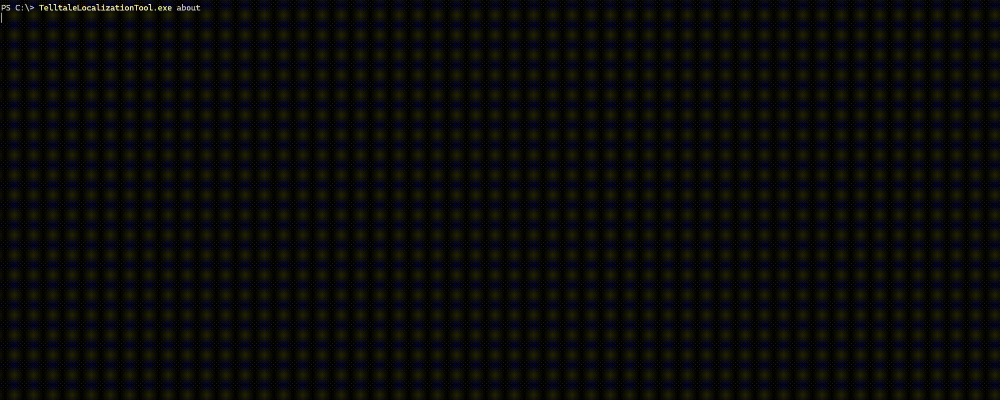

# TelltaleLocalizationTool


A Windows command-line tool for localizing Telltale games on Android, with particular attention to Persian text and fonts. It started as a hobby project for fun and learning, and that’s still why I work on it. Development is ongoing.

| Android game | `--game` | Status |
| --- | --- | --- |
| The Walking Dead: A New Frontier (Season Three) | `WDS3NF` | Main target; the localization workflow has been tested in-game. |
| The Walking Dead: Season One | `WDS1` | Experimental; text has been checked in-game, but the full workflow hasn’t been tested end to end. |

## Quick start

From the folder containing `TelltaleLocalizationTool.exe` and `appsettings.json`, open PowerShell and run `./TelltaleLocalizationTool.exe --help`. To run from source instead, install the .NET 9 SDK and use `dotnet run -c Release --` in place of `./TelltaleLocalizationTool.exe` from the repository root.

Start with an extracted `.landb` file. Export it, edit the text in the XML while preserving its structure, then import the XML to a new file:

```powershell
./TelltaleLocalizationTool.exe export landb -g WDS3NF -i "original/dialogue.landb" -o "work/dialogue.xml"
./TelltaleLocalizationTool.exe import landb -g WDS3NF -i "work/dialogue.xml" -o "translated/dialogue.landb"
```

Put the rebuilt file into your mod using your usual game-specific workflow, then check the result in-game. The tool works on extracted assets; it does not unpack or repack game archives.

## Fonts, textures, and batch work

- **Fonts:** `export font` writes an XML BMFont `.fnt` and DDS atlas pages. Keep the atlas files next to the FNT and use `import font` with the FNT as input to rebuild a `.font`. Set `CompressonatorPath` in `appsettings.json` to your Compressonator CLI 4.5.52 (tested version) executable for font atlas compression.
- **TrueType fonts:** Set `BmfontPath64` to your `bmfont64.exe` to use `import ttf`. For example: `./TelltaleLocalizationTool.exe import ttf -g WDS3NF -i "fonts/translation.ttf" -o "translated/dialogue.font" --glyphSize 32`. Use `--fallback-ttf` if the primary font is missing glyphs.
- **Textures:** `export d3dtx` writes an image (such as DDS or PNG) and a `.d3dtx.xml` metadata file. Keep the metadata with the edited image for `import d3dtx`. WDS1 texture import supports `--format ETC1`, `ARGB4`, or `ARGB8`; the default is automatic, and ETC1 discards transparency.
- **Folders:** Add `--batch` and pass directories to `-i` and `-o`. Add `--relative` to include subfolders and preserve their layout. Existing outputs are kept unless you pass `--force`.
- **Persian text:** On LANDb import, `--text_transform shaped` applies Persian shaping, `logical` normalizes the text to logical form, and `none` leaves it unchanged. If you omit the option, import follows the XML’s `textTransform` setting.



## Credits

This project was made possible by the work of these projects and their communities:

- [Telltale Texture Tool](https://github.com/Telltale-Modding-Group/Telltale-Texture-Tool) provided the foundation for the texture work.
- [TelltaleInspector](https://github.com/LucasSaragosa/TelltaleInspector) made it possible to inspect and understand the game files.
- [TelltaleToolLib](https://github.com/LucasSaragosa/TelltaleToolLib) provided a reference for Telltale’s metadata symbols.
- [AMD Compressonator](https://github.com/GPUOpen-Tools/compressonator) powers the texture compression used in the Android workflow.
- [AngelCode BMFont](https://www.angelcode.com/products/bmfont/) generates the bitmap font atlases and XML descriptors used when importing TrueType fonts.

## Community and support

If you'd like to follow the project, you're welcome to join the [ByteAndPlay Telegram channel](https://t.me/ByteAndPlay).

**Hey localizers:** If this tool helped with a paid translation, a tip(Donate,[stars](https://t.me/ByteAndPlay)) is cool ;).. And hey… who even plays Telltale games these days? I mainly build this to practice modding, reverse engineering, and file-format analysis. Tips are a bonus, not the point.

## So, what are the next steps?
IDK, maybe writing documentation? or expanding the tool to support different formats like D3dmesh... nothing's decided yet. Honestly, who cares?

## License

Original project material is covered by the [custom license](LICENSE). It allows commercial use with credit, but it is not an OSI-approved open-source license. Third-party components have separate terms; see [THIRD-PARTY-NOTICES.md](THIRD-PARTY-NOTICES.md). In particular, the license for some NuGet dependencies could not be confirmed, so check those permissions before distributing a bundled build.

For a paid translation made using material covered by this project's license, put a credit like this on its sales or download page:

> Created using [TelltaleLocalizationTool](https://github.com/MRJAPPS/TelltaleLocalizationTool) by ByteAndPlay.

You're welcome to credit yourself for your translation or your own code changes. Keep the original project credits when redistributing the tool. Donations are optional.
